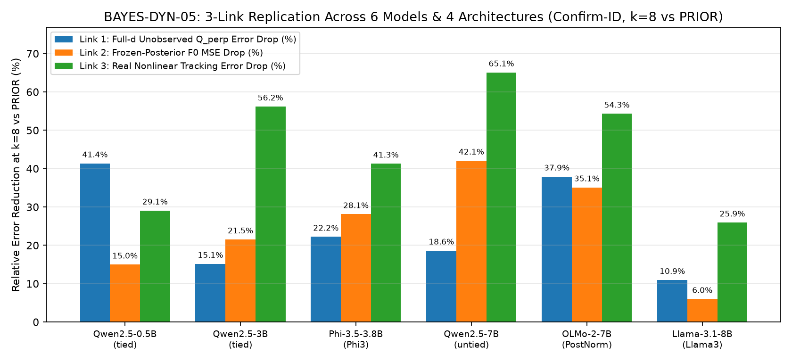
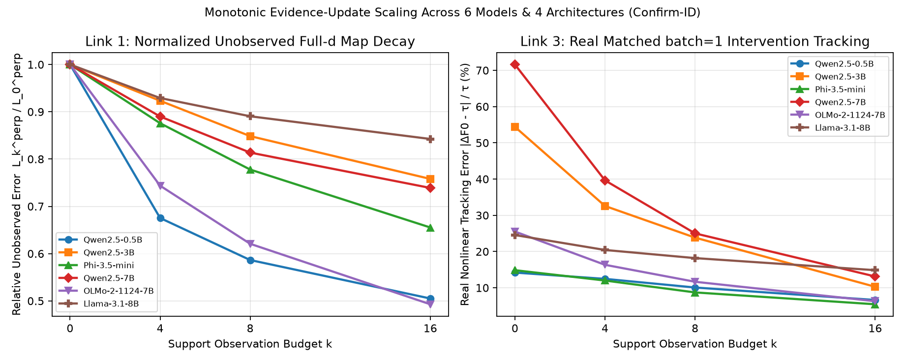
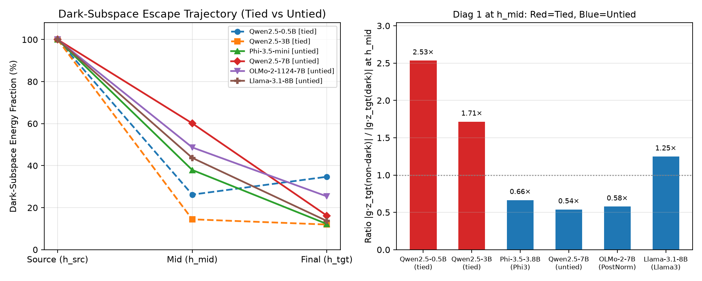
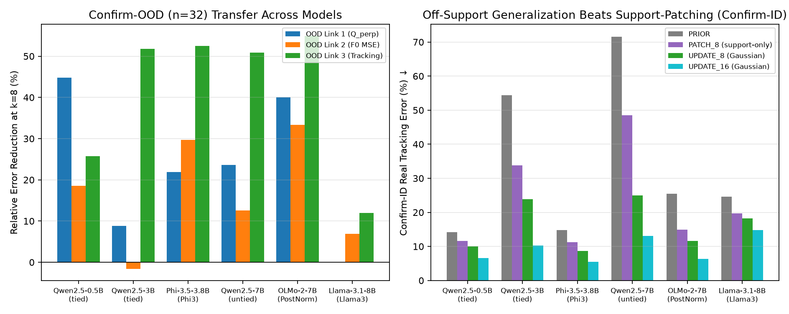

# Evidence-Updated Local Dynamics Maps in the Unembedding Dark Subspace

**Cross-Scale (0.5B–8B) & Cross-Architecture Verification of Full-Residual Dark-Tail Propagation, Frozen-Posterior Functional Prediction, and Nonlinear Causal Intervention**

**Status:** **6/6 Models Complete & Independently Audited (`0` Violations across 2,432 Replayed Posterior States)**  
**Full Bilingual Abstract:** Directly below and in [`ABSTRACT.md`](ABSTRACT.md).

---

## Abstract

Representational analyses of transformer language models show that directions lying in the low-singular-value ("dark") tail of the unembedding matrix often carry strong task-discriminative signal, yet intervening along static linear directions typically yields weak or unreliable causal control. A central obstacle is that perturbations injected into the dark tail undergo strong context-dependent cross-layer transport into the full residual stream, which low-rank output truncations and noisy observation updates fail to capture. We formulate late-layer propagation from the 38-dimensional darkest unembedding tail (`round(2L/3) -> L`, pre-final RMSNorm) into the full $d$-dimensional active residual space as a context-conditioned matrix-Gaussian operator $A_c = (J_c - I)V_{\text{dark}} \in \mathbb{R}^{d \times 38}$, updated via exact deterministic Gaussian conditioning from a small budget of target-agnostic forward-mode Jacobian–vector product (JVP) probes ($k \in \{4, 8, 16\}$). Across six instruction-tuned models spanning 0.49B to 8.03B parameters and four distinct architectures (`Qwen2.5-0.5B/3B/7B`, `Phi-3.5-mini-3.8B`, Post-RMSNorm + QK-Norm `OLMo-2-7B`, and `Llama-3.1-8B`), all executed in exact FP32 under strict pre-commit and evaluator isolation verified by independent pure-NumPy audits (2,432 replayed posterior states, zero violations), $k=8$ probes reduce unobserved strictly-orthogonal full-$d$ prediction error by **10.9%–41.4%** in-distribution (6/6 models, 95% paired bootstrap CIs strictly positive), lower frozen-posterior functional logit-margin MSE without refitting by **15.0%–42.1%** on 5/6 models (`-6.0%` n.s. on `Llama-3.1-8B` at $k=8$, `-14.9%` strictly positive at $k=16$), and cut matched `batch=1` nonlinear intervention tracking error $|\Delta F_0(x_k)-\tau|/\tau$ by **25.9%–65.1%** in-distribution and **12.0%–54.9%** out-of-distribution across all 6/6 models, strictly outperforming support-only patching (`PATCH_8`) on all 6/6 models in-distribution (`+1.48 pp` to `+23.52 pp`). At $k=16$, all **36/36** model × split (ID/OOD) × link tests achieve strictly positive 95% CIs, whereas mispaired observations consistently degrade map error (`+9.0%` to `+25.4%`). Inter-layer trajectory panels further reveal universal dark-to-bright escape—leaving only **12.0%–34.7%** dark-subspace energy at the final layer while amplifying in norm (`1.89×–2.89×`)—with earlier mid-layer rotation in tied-embedding models (`14.5%–26.2%` dark energy remaining at $h_{\text{mid}}$) versus later conversion in untied models (`37.9%–60.1%` at $h_{\text{mid}}$). These findings establish across scales and architectures that evidence-updated full-residual local dynamics maps bridge passive dark-subspace readability and reliable nonlinear causal control.

### 摘要（中文）

对 Transformer 语言模型的表征分析表明，位于反嵌入矩阵小奇异值尾部（“暗子空间”）的方向常包含显著的任务区分信号，但沿静态线性方向施加干预往往难以产生稳定、准确的因果控制。其核心障碍在于，注入暗尾的扰动在跨层传播中会发生强烈的上下文相关旋转与放大并涌入完整 $d$ 维残差流，而低秩输出截断与含噪观测更新会丢弃过半真实主动传播误差。我们将末层段（`round(2L/3) -> L`，最终 RMSNorm 之前）从最暗 38 维反嵌入尾到完整 $d$ 维残差流的主动传播算子 $A_c = (J_c - I)V_{\text{dark}} \in \mathbb{R}^{d \times 38}$ 建模为上下文条件化的矩阵高斯先验，并仅利用少量目标无关的前向 JVP 探测观测（$k \in \{4, 8, 16\}$），通过精确确定性高斯条件化实现在线后验更新。在横跨 0.49B–8.03B 参数规模与四类不同架构（`Qwen2.5-0.5B/3B/7B`、`Phi-3.5-mini-3.8B`、采用 Post-RMSNorm + QK-Norm 的 `OLMo-2-7B` 及 `Llama-3.1-8B`）的全 FP32 严格隔离实验中，经独立纯 NumPy 审计（重放 2,432 个后验状态、零违规）验证：$k=8$ 次观测在 6/6 模型上均显著降低严格正交未测方向的完整 $d$ 维预测误差（分布内 **-10.9% 至 -41.4%**），在 5/6 模型上显著降低冻结后验功能读出 MSE（**-15.0% 至 -42.1%**；`Llama-3.1-8B` 在 $k=8$ 为 `-6.0%` 擦边跨零，于 $k=16$ 达显著 **-14.9%**），并在全部 6/6 模型的分布内（**-25.9% 至 -65.1%**）与分布外（**-12.0% 至 -54.9%**）均显著压低真实匹配 `batch=1` 非线性干预追踪误差，且在全部 6/6 模型分布内显著打赢纯支撑修补对照；在 $k=16$ 下，全部 **36/36** 项模型×划分×链路检验的 95% 置信区间均严格大于零。跨层轨迹面板进一步揭示了普适的暗→亮逃逸机制（末层仅残余 **12.0%–34.7%** 暗子空间能量），并在共享反嵌入模型（中层即降至 `14.5%–26.2%`）与非共享反嵌入模型（中层保持 `37.9%–60.1%` 后于末段集中转化）间呈现清晰的结构分化。

---

## Headline Visual Results

### 1. 3-Link Replication Across 6 Models & 4 Architectures (Confirm-ID, $k=8$)


### 2. Monotonic Evidence-Budget Scaling ($k \in \{0, 4, 8, 16\}$)


### 3. Inter-Layer Dark-Subspace Escape Mechanism (Tied vs. Untied Regimes)


### 4. Out-of-Distribution Transfer & Off-Support Generalization vs. Support-Patching


---

## Quantitative Summary Tables

### Confirm-ID (Primary Panel, `k=8` vs `PRIOR`, 20,000 Family-Stratified Paired Bootstrap)

| Model | Architecture | Params | `d` | Tied | Link 1: Unobs `Q_perp` (`k=8` / `k=16`) | `MISPAIRED_8` | Link 2: Frozen `F0` MSE (`k=8` / `k=16`) | Link 3: Real Tracking Err (`PRIOR → U8 → U16`, `k=8` Drop) | `PATCH_8 → UPDATE_8` Net Gain (`95% CI`) | P0 & CPU Audit |
|---|---|---:|---:|---|---:|---:|---:|---:|---:|---|
| `Qwen2.5-0.5B-Instruct` | Qwen2 (Pre-RMSNorm) | 0.49B | 896 | Yes | **-41.4%** / -49.5% (PASS) | +22.2% worse | **-15.0%** / -28.7% (PASS) | 14.2% → **10.1%** → 6.6% (**-29.1%**, PASS) | +1.55 [+0.51, +2.66] pp (PASS) | PASS (0 viol) |
| `Qwen2.5-3B-Instruct` | Qwen2 (Pre-RMSNorm) | 3.09B | 2048 | Yes | **-15.1%** / -24.2% (PASS) | +13.4% worse | **-21.5%** / -31.5% (PASS) | 54.4% → **23.8%** → 10.3% (**-56.2%**, PASS) | +9.95 [+5.67, +14.37] pp (PASS) | PASS (0 viol) |
| `Phi-3.5-mini-instruct` | Phi-3 (Fused QKV/MLP) | 3.82B | 3072 | No | **-22.2%** / -34.5% (PASS) | +19.6% worse | **-28.1%** / -48.8% (PASS) | 14.8% → **8.7%** → 5.4% (**-41.3%**, PASS) | +2.51 [+0.81, +4.30] pp (PASS) | PASS (0 viol) |
| `Qwen2.5-7B-Instruct` | Qwen2 (Pre-RMSNorm) | 7.62B | 3584 | No | **-18.6%** / -26.1% (PASS) | +9.8% worse | **-42.1%** / -52.5% (PASS) | 71.6% → **25.0%** → 13.1% (**-65.1%**, PASS) | +23.52 [+17.04, +30.32] pp (PASS) | PASS (0 viol) |
| `OLMo-2-1124-7B-Instruct` | OLMo-2 (**Post-RMSNorm + QK-Norm**) | 7.30B | 4096 | No | **-37.9%** / -50.7% (PASS) | +25.4% worse | **-35.1%** / -54.2% (PASS) | 25.5% → **11.7%** → 6.3% (**-54.3%**, PASS) | +3.32 [+0.78, +5.95] pp (PASS) | PASS (0 viol) |
| `Llama-3.1-8B-Instruct` | Llama-3.1 (Pre-RMSNorm) | 8.03B | 4096 | No | **-10.9%** / -15.8% (PASS) | +9.0% worse | -6.0% (n.s.) / **-14.9%** (PASS@16) | 24.6% → **18.2%** → 14.9% (**-25.9%**, PASS) | +1.48 [+0.79, +2.21] pp (PASS) | PASS (0 viol) |

### Confirm-OOD (`n=32`, Two-Stage Conditional Update + Relational Lookup)

| Model | OOD Link 1 (`Q_perp`, `k=8` / `k=16`) | OOD Link 2 (`F0` MSE, `k=8` / `k=16`) | OOD Link 3 (Tracking Err `PRIOR → U8 → U16`, `k=8` Drop) | OOD `PATCH_8 → UPDATE_8` |
|---|---:|---:|---:|---:|
| `Qwen2.5-0.5B-Instruct` | **-44.8%** / -53.6% (PASS) | -18.5% / -34.5% (PASS) | 14.4% → **10.7%** → 6.6% (**-25.7%**, PASS) | +1.94 [-0.09, +3.97] pp (n.s.) |
| `Qwen2.5-3B-Instruct` | **-8.8%** / -17.7% (PASS) | +1.6% (n.s.) / **-11.6%** (PASS@16) | 81.5% → **39.3%** → 19.5% (**-51.8%**, PASS) | +1.09 [-6.57, +8.89] pp (n.s.) |
| `Phi-3.5-mini-instruct` | **-21.9%** / -32.8% (PASS) | -29.7% / -42.9% (PASS) | 23.2% → **11.0%** → 7.0% (**-52.5%**, PASS) | +1.91 [-0.41, +4.40] pp (n.s.) |
| `Qwen2.5-7B-Instruct` | **-23.6%** / -34.3% (PASS) | -12.6% / -23.3% (PASS) | 65.4% → **32.2%** → 17.1% (**-50.8%**, PASS) | +6.59 [-0.02, +13.13] pp (n.s.) |
| `OLMo-2-1124-7B-Instruct` | **-40.0%** / -52.6% (PASS) | -33.3% / -49.0% (PASS) | 44.0% → **19.8%** → 14.1% (**-54.9%**, PASS) | **+9.91 [+5.67, +14.33] pp (PASS)** |
| `Llama-3.1-8B-Instruct` | 0.0% (n.s.) / **-3.2%** (PASS@16) | **-6.9%** / -12.3% (PASS) | 48.2% → **42.4%** → 36.9% (**-12.0%**, PASS) | **+0.78 [+0.19, +1.39] pp (PASS)** |

---

## Scientific Integrity, Isolation & Independent Verification

Every experiment enforces strict pre-registration and zero-leakage verification:

- **Exact Numerical Fidelity (P0 Gate):** Pure FP32 with TF32 disabled and `attn_implementation="eager"`. For 7B/8B models on 24 GB GPUs, exact split-isolated prefix streaming keeps suffix layers + norm + `lm_head` resident in FP32 and verifies streamed logits against untouched native CPU `model(...)` forward passes (`max diff <= 7.92e-5`), zero-perturbation `D_geom == 0.0` and `|ΔF0| == 0.0`, JVP vs. central finite-difference error `1.29e-4–3.74e-4`, and JVP/VJP adjoint consistency `1.89e-6–8.19e-5`.
- **Chronological Stage-A / Stage-B Isolation:** Every Stage-A map posterior (`M_k` float32 SHA-256) and intervention vector (`x_k`) is committed to `predictions.jsonl` strictly before Stage-B evaluator probes or exact target VJPs are queried. Learning sessions are structurally prohibited from calling VJP (`allow_vjp=False`).
- **Independent Pure-NumPy CPU Audits (Zero PyTorch Dependency):**
  - `bayes_dyn_04_qwen05b/audit/`: replayed 512 posterior states (`M_k <= 2.38e-7`, `C_k <= 2.66e-15`, support residual `<= 1.02e-12`), verified 128 chronological commits & 14/14 frozen SHA-256s, **0 violations**.
  - `bayes_dyn_05_cross_scale/audit/audit_model_v05.py`: replayed 384 posterior states × 5 models = **1,920 posterior states** (`C_k <= 2.22e-15`, support residual `<= 1.23e-12`), verified 240/240 byte-exact trajectory `M_k` SHA-256s, 480 chronological commits, 600 learning / 740 evaluator session receipts, and 70/70 frozen SHA-256s across all 5 new models—**0 violations**.
- **Compute Transparency:** Entire 5-model cross-scale/cross-architecture FP32 replication (`3B + Phi-3.5 + Qwen-7B + OLMo-2-7B + Llama-3.1-8B`) settled at **`5.25 Colab Compute Units`** total (~0.16 CU for 0.5B reference; full verbatim stop & usage receipts archived in `runtime/`).

---

## Repository Structure & Binary Tensor Release

```text
dark-subspace-dynamics/
├── README.md                              # Bilingual abstract, 6-model figures, tables & verification guide
├── ABSTRACT.md                            # Standalone bilingual (EN / ZH) abstract
├── LICENSE                                # MIT License
├── figures/                               # All publication figures (6-model cross-scale + 0.5B reference)
├── bayes_dyn_04_qwen05b/                  # Deep-dive reference study on Qwen2.5-0.5B-Instruct (n=96 ID, 32 OOD)
└── bayes_dyn_05_cross_scale/              # 5-model cross-scale & cross-architecture suite (3B -> 8.03B)
    ├── FINDINGS.md                        # Cross-model master report
    ├── generate_suite_report_v05.py       # Cross-model table & figure synthesis script
    ├── run_bayes_dyn_05_model.py          # Full-GPU FP32 driver (3B / 3.8B)
    ├── run_bayes_dyn_05_7b_stream.py      # Exact FP32 layer-streamed driver (7B / 8B on 24 GB L4)
    ├── src/                               # Cross-architecture spectral SVD, JVP/VJP, exact conditioning
    ├── configs/ & data/                   # Pinned model SHAs, 248 zero-overlap balanced prompts
    ├── audit/audit_model_v05.py           # Independent pure-NumPy per-model auditor
    ├── models/<model_key>/                # Per-model P0, metrics, interventions, trajectory, audit_report.json
    └── runtime/                           # Watchdog with kernel keepalive, logs & verbatim stop receipts
```

Raw binary NumPy tensor archives (`prior_model.npz`, `*_obs.npz`, `*_posteriors.npz`, `traj12_M_k.npz` — ~590 MB across all 6 models) are published permanently under **[GitHub Release `v0.1.0-artifacts`](https://github.com/axobase001/dark-subspace-dynamics/releases/tag/v0.1.0-artifacts)** with `SHA256SUMS.txt`.

To independently audit any model on CPU (requires only `numpy`, no GPU or PyTorch):
```bash
# Download & extract the model's .npz archive from Release v0.1.0-artifacts into bayes_dyn_05_cross_scale/
python bayes_dyn_05_cross_scale/audit/audit_model_v05.py --model_key llama31_8b
```

---

## Citation

```bibtex
@misc{darksubspacedynamics2026,
  title  = {Evidence-Updated Local Dynamics Maps in the Unembedding Dark Subspace: Cross-Scale and Cross-Architecture Verification},
  author = {Anonymous Authors},
  year   = {2026},
  url    = {https://github.com/axobase001/dark-subspace-dynamics}
}
```
